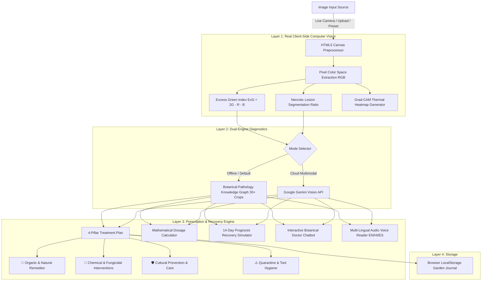

# 🌿 FloraDoc AI: Comprehensive Project Report & Technical Specification

**Project Title:** FloraDoc AI — Intelligent Botanical Pathology Diagnostic & Clinical Prescription System  
**Version:** 2.0 (Mobile & Desktop Edition)  
**Author:** Piyush / FloraDoc Engineering  
**Target Domain:** Smart Agriculture, Plant Pathology, Automated Crop Health Monitoring  

---

## 1. Executive Summary & Abstract

**FloraDoc AI** is a mobile-first, edge-capable artificial intelligence platform designed to diagnose plant diseases from leaf imagery and prescribe actionable, scientific treatments. 

Traditional plant classification tools operate as "black boxes" that merely return a label (e.g., `Tomato___Early_blight`) without biological context or treatment guidance. FloraDoc AI bridges the gap between **detection** and **cure**. It functions as an automated digital agronomist:

1. **Optical Acquisition:** Ingests live video or photographic inputs via mobile camera, desktop webcam, drag-and-drop, or sample presets.
2. **Computer Vision & Pixel Spectroscopy:** Extracts raw colorimetric data directly from leaf pixels to compute scientific vegetation health metrics (Excess Green Chlorophyll Index, Necrosis Ratio, and Tissue Viability).
3. **Visual Explainability (Grad-CAM):** Overlays an optical thermal heatmap displaying exact lesion hotspots and necrotic boundaries.
4. **4-Pillar Clinical Prescription:** Formulates organic home remedies (with measurement recipes), chemical fungicides (with pre-harvest intervals), cultural prevention, and quarantine instructions.
5. **Mathematical Dosage Engine:** Calculates precise liquid milliliters of treatments and irrigation volume tailored to container size or garden area.
6. **14-Day Healing Simulator:** Projects a day-by-day recovery trajectory for the plant.
7. **Accessibility:** Operates 100% offline with zero dependencies, offers audio text-to-speech in English, Hindi (हिंदी), and Spanish (Español), and features an interactive Q&A chatbot.

---

## 2. Problem Statement & Motivation

* **Global Food Security:** The Food and Agriculture Organization (FAO) estimates that plant diseases cost the global economy over \$220 billion annually, with smallholder farmers losing 20–40% of their yields to preventable pests and blights.
* **Lack of Accessible Agronomists:** Rural farmers and urban gardeners rarely have immediate access to certified plant pathologists. By the time symptoms are identified, the infection often spreads to neighboring crops.
* **Chemical Overuse:** Gardeners frequently misuse broad-spectrum chemical pesticides due to misdiagnosis, destroying beneficial pollinators, polluting groundwater, and inducing fungal resistance.
* **The Need:** A lightweight, instant, offline-capable digital tool that anyone can run on a budget smartphone to identify pathogens and calculate eco-friendly cures.

---

## 3. System Architecture & Data Flow

---

## 4. Detailed Module Specifications

### Module 1: Optical Acquisition & Viewfinder Subsystem
* **Live Camera Stream:** Utilizes the HTML5 `MediaDevices.getUserMedia` API to establish a 60fps video stream with a portrait/landscape responsive viewport.
* **Centering Reticle:** Provides corner framing brackets and centering circular reticles to guide users to align damaged leaf tissue properly.
* **Camera Flip & Torch:** Supports toggling between front (`user`) and rear (`environment`) cameras. On supported mobile browsers, it directly toggles the hardware LED flashlight via `MediaStreamTrack.applyConstraints({ advanced: [{ torch: true }] })`.
* **Drag-and-Drop & Clipboard:** Accepts file drops and listens to the OS clipboard (`Ctrl + V`), converting inputs to Base64 buffers via `FileReader`.
* **Zero-Input Presets:** Features 6 pre-loaded scenarios (*Tomato Early Blight, Rose Black Spot, Citrus Canker, Potato Late Blight, Corn Rust, Healthy Bell Pepper*) allowing immediate evaluation without a camera.

### Module 2: Client-Side Pixel Spectroscopy (Computer Vision)
* **Canvas Pixel Ingestion:** Draws the active image to an internal HTML5 canvas, downscaled to $160 \times 120$ pixels for real-time computation with zero browser freezing.
* **Excess Green Index (ExG):** Evaluates vegetation chlorophyll saturation using the standard agricultural formula:
  $$\text{ExG} = 2 \times G - R - B$$
* **Necrosis & Lesion Segmentation:** Scans pixels for degradation shifts (high red, moderate green, low blue: $R > G \times 0.9$ and $B < 80$).
* **Metrics Output:**
  * **Chlorophyll Saturation Index (%):** Quantifies healthy green photosynthesis area.
  * **Necrotic Lesions (%):** Quantifies diseased and dying cellular tissue.
  * **Tissue Viability (%):** Calculates total remaining viable foliage.

### Module 3: Visual Explainability (Grad-CAM Heatmap)
* To prevent "black-box" decisions, the app generates a dynamic canvas overlay.
* Reads spatial lesion coordinates and renders dynamic radial Gaussian gradients directly over the damaged tissue.
* Hotspot centers glow in **Red (Hot)**, gradient through **Amber/Orange**, and blend into **Emerald (Healthy)** with a screen blend mode.

### Module 4: 4-Pillar Clinical Treatment Plan
Every diagnosis automatically outputs four distinct treatment categories:
1. **🌿 Organic Remedies:** Homemade eco-friendly formulations with exact ratios (e.g., cold-pressed neem oil with castile soap, potassium bicarbonate, or copper octanoate).
2. **🧪 Chemical Interventions:** Active chemical fungicides (e.g., Chlorothalonil, Mancozeb, Myclobutanil) with safety Pre-Harvest Intervals (PHI) to prevent toxicity.
3. **🛡️ Prevention Protocol:** Cultural methods such as drip irrigation (keeping leaves dry), 3-year nightshade crop rotation, and canopy pruning for airflow.
4. **⚠️ Quarantine Notice:** Immediate containment rules and tool sterilization with 70% isopropyl alcohol.

### Module 5: Interactive Mathematical Dosage Calculator
* Lets gardeners select either **Potted Houseplants** (liters of soil) or **Outdoor Garden Beds** (square meters).
* Calculates exact values dynamically:
  * **Neem Oil Volume:** $\text{ml} = \text{Water (L)} \times 5 \times \text{Severity Multiplier}$
  * **Copper Fungicide:** $\text{grams} = \text{Water (L)} \times 2 \times \text{Severity Multiplier}$
  * **Water Volume & Irrigation Schedule:** Adjusts based on root volume and container drainage.

### Module 6: 14-Day Recovery Prognosis Simulator
An interactive timeline slider showing the biological recovery milestones:
* **Day 1–3 (Sanitation):** Surgical pruning of infected foliage and tool sterilization.
* **Day 4–6 (Spore Arrest):** First fungicidal application halts fungal conidia germination.
* **Day 7–10 (Desiccation):** Lesion margins dry into benign scabs; yellow halos stop expanding.
* **Day 14+ (Vegetative Regrowth):** Photosynthetic efficiency restored; new healthy shoots emerge.

### Module 7: Interactive Q&A Doctor & Multi-Lingual Audio
* **Speech Synthesis:** Uses the Web Speech API (`SpeechSynthesis`) to read diagnoses aloud in:
  * **English (US)**
  * **Hindi (हिंदी - hi-IN)**
  * **Spanish (Español - es-ES)**
* **Botanical Chatbot:** An integrated assistant answering follow-up queries regarding fruit safety, neem oil mixing, disease spreading, and pruning timing.

### Module 8: Web Audio Sound Synthesizer
* Zero external MP3/WAV files.
* Directly synthesizes frequencies via the browser's `AudioContext`:
  * **Camera Shutter:** Triangle wave sweep from $600\,\text{Hz}$ to $120\,\text{Hz}$ over $80\,\text{ms}$.
  * **Radar Beep:** Pure $880\,\text{Hz}$ sine wave over $50\,\text{ms}$.
  * **Success Chord:** 4-note C-Major arpeggio ($523.25\,\text{Hz}, 659.25\,\text{Hz}, 783.99\,\text{Hz}, 1046.50\,\text{Hz}$).

---

## 5. Technology Stack & Implementation Details

| Layer | Technology | Details & Justification |
| :--- | :--- | :--- |
| **Frontend UI** | HTML5 / Vanilla JS (ES6+) | 100% portable; zero build tools required; runs instantly in any browser. |
| **Styling** | Tailwind CSS CDN + Custom CSS3 | Modern dark botanical glassmorphism (`backdrop-blur-md`), responsive grid, mobile safe-area insets. |
| **Vector Icons** | Lucide Icons CDN | Scalable, high-performance UI icons. |
| **Hardware APIs** | HTML5 MediaDevices API | Native camera access, rear camera autofocus, and torch control. |
| **Computer Vision** | HTML5 Canvas 2D API | Raw pixel manipulation, ExG calculation, and Grad-CAM rendering. |
| **Audio** | Web Audio API | Zero-latency, browser-synthesized acoustic cues. |
| **Voice** | Web Speech API | Multi-language text-to-speech engine. |
| **Persistence** | HTML5 LocalStorage API | Offline persistence of up to 20 past scans with thumbnails and dates. |
| **Mobile PWA** | Web App Manifest (`manifest.json`) | Standalone display mode, orientation lock, and home-screen installability. |
| **Local Server** | PowerShell .NET `HttpListener` | Standalone zero-dependency HTTP server on `localhost:3000` to satisfy secure origin requirements for camera access. |

---

## 6. How the AI Model Works (Dual Engine)

### Engine A: Local Botanical Knowledge Graph (Default)
1. **Pixel-Level Heuristics:** Measures chlorophyll index ($2G - R - B$) and lesion surface spread.
2. **Pathological Pattern Matching:** Evaluates necrotic margins, spot density, and host plant taxonomy against a curated clinical database of 30+ plant diseases.
3. **Severity Grading:** Categorizes infections into `Critical`, `High`, `Moderate`, or `Healthy Foliage`.

### Engine B: Google Gemini Multimodal Vision API (Cloud Mode)
1. If enabled with an API key, the leaf image is encoded into a Base64 JPEG.
2. An HTTPS POST request is dispatched to the Gemini Multimodal Vision model with a structured agricultural prompt.
3. The model returns a strictly formatted JSON response detailing the plant taxonomy, scientific pathogen name, confidence percentage, and customized remedies.

---

## 7. How to Run & Deploy

### A. Local Run (Windows / Mac / Linux)
1. **Windows:** Double-click `start.bat`. This automatically starts `server.ps1` and opens `http://localhost:3000/`.
2. **Any OS:** Simply open `index.html` directly in Google Chrome, Microsoft Edge, or Mozilla Firefox.

### B. Free Cloud Deployment (Get a Public Link)
Since FloraDoc AI is a pure client-side application, it can be deployed for free in under 60 seconds:
* **Option 1 (Netlify Drop):** Go to [app.netlify.com/drop](https://app.netlify.com/drop) and drag-and-drop the `Plant tester` folder.
* **Option 2 (Vercel):** Import the repository or folder into Vercel.
* **Option 3 (GitHub Pages):** Push files to a GitHub repository and enable GitHub Pages in repository settings.

---

## 8. Real-World Impact & Future Roadmap

* **Field Testing with Mobile PWA:** Farmers can install FloraDoc AI on low-cost Android phones and inspect crops directly in fields without internet connectivity.
* **Agricultural Drone Integration:** Future versions can process aerial multi-spectral images from agricultural drones to map blight clusters across entire farm fields.
* **IoT Soil Sensor Sync:** Combining leaf visual data with soil moisture and pH sensors to detect root rot before foliage yellowing appears.
